# Did Germany really save electricity in the 2022 energy crisis?

*Generated 2026-10-10T11:29:36+00:00 from data up to 2026-10-10 09:00:00+00:00.*

## The short answer

**Germany used 8.8% less grid electricity in winter 2022/23 than the weather predicted (90% range 6.2% to 11.2%).**

In winter 2022/23 (October to March), Germany's grid delivered 8.8% less electricity than the weather and calendar predicted (90% range 6.2% to 11.2%), about 23.1 TWh. Demand has NOT fully come back: in 2025/26 it was still 4.2% below the pre-crisis pattern (range 1.5% to 6.8%). Counting only dark hours (when rooftop solar can't hide demand), the 2022/23 saving was 9.2%.

## Saving per winter (October to March)

| Winter | Real use (TWh) | Expected without crisis (TWh) | Saving (TWh) | Saving | 90% range | Years past training |
|---|---|---|---|---|---|---|
| 2021/22 | 264.5 | 264.5 | -0.0 | -0.0% | -2.8% to 2.7% | 0.0 |
| 2022/23 | 240.4 | 263.5 | 23.1 | 8.8% | 6.2% to 11.2% | 0.08 |
| 2023/24 | 245.1 | 263.5 | 18.4 | 7.0% | 4.3% to 9.5% | 1.08 |
| 2024/25 | 246.1 | 263.2 | 17.1 | 6.5% | 3.8% to 9.0% | 2.08 |
| 2025/26 | 251.9 | 263.1 | 11.2 | 4.2% | 1.5% to 6.8% | 3.08 |

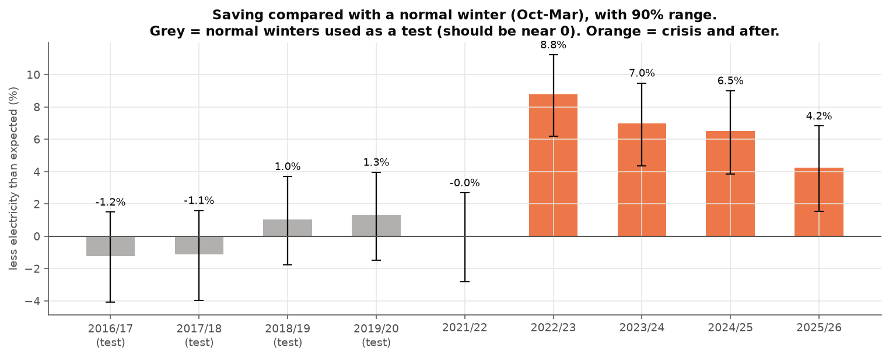

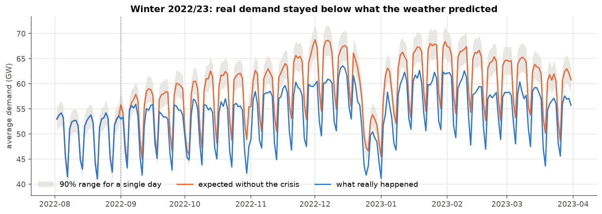

## Step 4: does the method work? Tests on normal winters

Each normal winter was forecast using only older data, as if it were unknown, from the same distances ahead as the crisis winters. In a normal winter the 'saving' should be about 0.

| Test winter | Years ahead | Whole-winter error | Daily error | Hourly error | Hourly error of 'same week last year' |
|---|---|---|---|---|---|
| 2016/17 | 0 | 1.2% | 1.7% | 1.9% | 4.0% |
| 2017/18 | 0 | 1.1% | 2.2% | 2.5% | 3.7% |
| 2017/18 | 1 | 2.3% | 2.6% | 2.9% | 3.7% |
| 2018/19 | 0 | -1.0% | 1.9% | 2.2% | 4.3% |
| 2018/19 | 1 | -0.0% | 1.8% | 2.1% | 4.3% |
| 2018/19 | 2 | 0.9% | 2.0% | 2.3% | 4.3% |
| 2019/20 | 0 | -1.3% | 2.6% | 2.9% | 3.8% |
| 2019/20 | 1 | -2.4% | 3.2% | 3.5% | 3.8% |
| 2019/20 | 2 | -1.4% | 2.8% | 3.1% | 3.8% |
| 2019/20 | 3 | -0.5% | 2.6% | 2.9% | 3.8% |

Typical whole-winter error: about 1.5% for the next winter, growing with each year ahead. On average the model was off by +0.0% plus -0.1% per year ahead (mostly because demand was slowly falling before 2022). The ranges above are built from these errors.

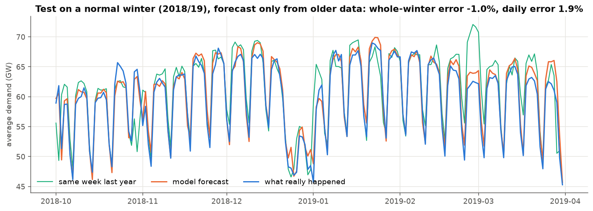

## Why the weather adjustment matters

| Winter | Raw change vs. 2016-2020 winters | Explained by weather & calendar | Saving | Left over |
|---|---|---|---|---|
| 2021/22 | 0.6% | 0.5% | -0.0% | 0.1% |
| 2022/23 | -8.6% | 0.1% | 8.8% | 0.1% |
| 2023/24 | -7.3% | -0.4% | 7.0% | 0.1% |
| 2024/25 | -6.4% | 0.0% | 6.5% | 0.1% |
| 2025/26 | -4.2% | -0.0% | 4.2% | 0.1% |

Comparing with a plain 2017-2019 average (no weather adjustment) would give 8.9% for 2022/23, instead of 8.8%.

## Does the answer depend on our choices?

| View | Winter | Saving | 90% range |
|---|---|---|---|
| cutoff 2021-09-01 | 2022/23 | 7.9% | 5.3% to 10.4% |
| cutoff 2021-09-01 | 2025/26 | 3.3% | 0.5% to 5.9% |
| cutoff 2022-03-01 | 2022/23 | 8.9% | 6.3% to 11.4% |
| cutoff 2022-03-01 | 2025/26 | 4.4% | 1.7% to 7.0% |
| cutoff 2022-09-01 | 2022/23 | 8.8% | 6.2% to 11.2% |
| cutoff 2022-09-01 | 2025/26 | 4.2% | 1.5% to 6.8% |
| Dec-Feb only | 2022/23 | 8.8% | 6.3% to 11.3% |
| Dec-Feb only | 2025/26 | 2.1% | -0.6% to 4.8% |
| dark hours only (no solar) | 2022/23 | 9.2% | 6.6% to 11.6% |
| dark hours only (no solar) | 2025/26 | 3.8% | 1.1% to 6.4% |
| lockdown months left out | 2022/23 | 8.7% | 6.1% to 11.1% |
| lockdown months left out | 2025/26 | 4.1% | 1.4% to 6.7% |
| corrected for known model bias (trend) | 2022/23 | 8.8% | 6.2% to 11.2% |
| corrected for known model bias (trend) | 2025/26 | 3.8% | 1.1% to 6.4% |
| dark hours + bias corrected (most cautious) | 2022/23 | 9.2% | 6.6% to 11.6% |
| dark hours + bias corrected (most cautious) | 2025/26 | 3.4% | 0.6% to 6.0% |
| simple average of 2017-19 (no weather adjustment) | 2022/23 | 8.9% | 6.3% to 11.3% |
| simple average of 2017-19 (no weather adjustment) | 2025/26 | 4.5% | 1.8% to 7.1% |

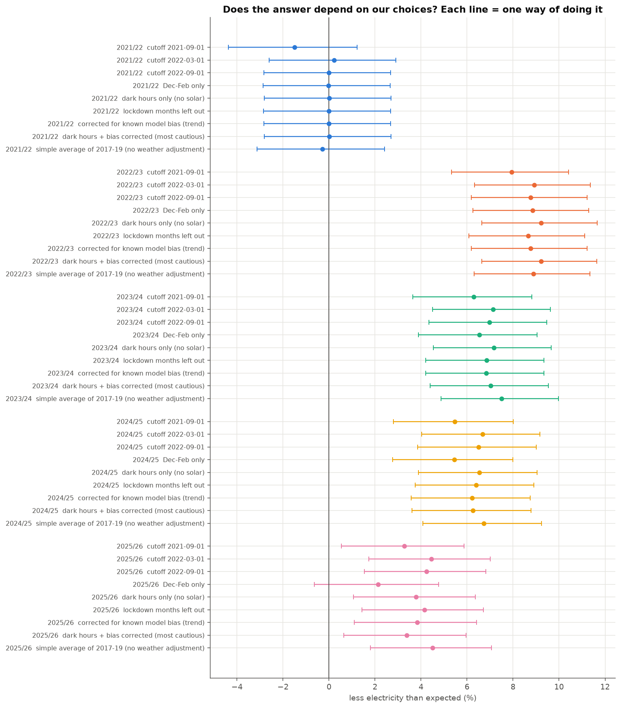

## When did the saving happen, and who might have saved?

In winter 2022/23 the saving was 8.8% on workdays and 8.8% on weekends and holidays (8.4% in workday daytime, 7:00-18:00).

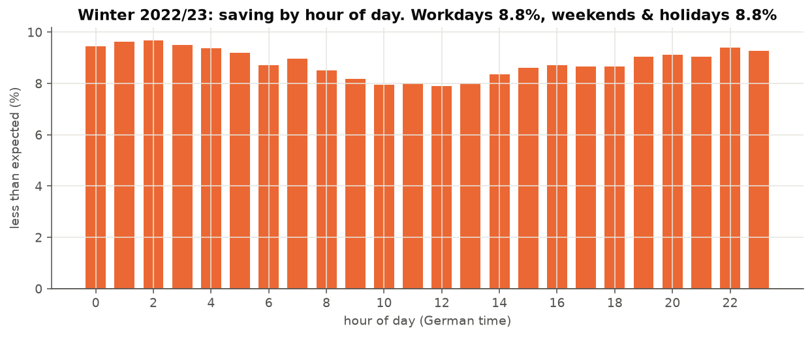

Energy-hungry industries (Paper, Chemicals, Glass, cement, ceramics, Basic metals) produced -12.6% compared with 2021 during winter 2022/23. Month by month, the saving and the drop in industrial output move together with a correlation of -0.40 (1 = in perfect step, 0 = unrelated) over 48 months.

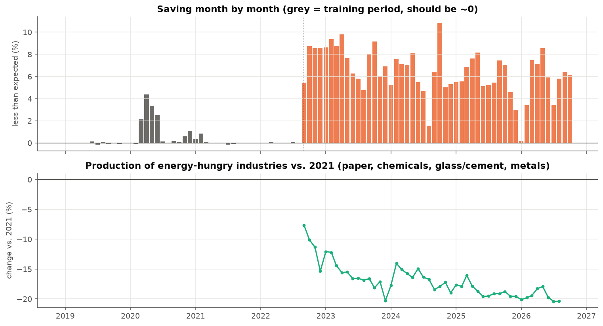

**What this analysis can and can't tell apart**

1. **Grid demand is not total use.** SMARD measures electricity flowing through the public grid.
   Power that rooftop solar panels make and use on the spot never shows up. Rooftop solar grew fast
   after 2022, so part of the "saving" in daytime hours may just be self-made solar power. The
   *dark hours only* view removes this: at night no panel produces anything.
2. **Industry or households?** One national number per hour can't say who saved. Two hints only:
   *when* the saving happened (workdays and daytime point to industry and offices; evenings and
   weekends point to homes), and whether energy-hungry industries produced less at the same time
   (Eurostat). A match in timing is a hint, not proof.
3. **Saving or cutting back?** A factory that stops making ammonia "saves" electricity, but that
   is lost production, not efficiency. The data can't tell a smarter fridge from a closed plant.
4. **Prices or appeals?** Prices jumped and the government asked people to save at the same time.
   Both pushed the same way in the same months, so their effects can't be separated here.
5. **New demand hides savings.** Heat pumps and electric cars added demand after 2022. The
   estimate is the *net* change: real savings could be larger than shown.
6. **The further ahead, the less sure.** The "no crisis" model learned from 2015 to August 2022.
   Every winter after that is forecast further into the future, so the ranges get wider. The model
   holds the last pre-crisis year's level; it can't know about slow changes after that.
7. **Starting date matters a little.** Prices already rose from autumn 2021. Training up to
   September 2022 may already include some early crisis behaviour, which would make the saving
   look smaller. The *cutoff* views show how much this changes the answer.

## Data checks

- Demand data: 103211 hours from 2014-12-31 23:00:00+00:00 to 2026-10-10 09:00:00+00:00; 12 23-hour days and 11 25-hour days (clock changes); 0 missing hours filled (no gap longer than 2 hours allowed).
- Cross-check with Open Power System Data (2015-01-01 to 2020-09-30): daily correlation 0.9883, SMARD is on average 1.028× OPSD (different definition of 'load', steady over the years: 2015: 1.0469, 2016: 1.0348, 2017: 1.0298, 2018: 1.0207, 2019: 1.0141, 2020: 1.0235).

## Exploring the data (step 2)

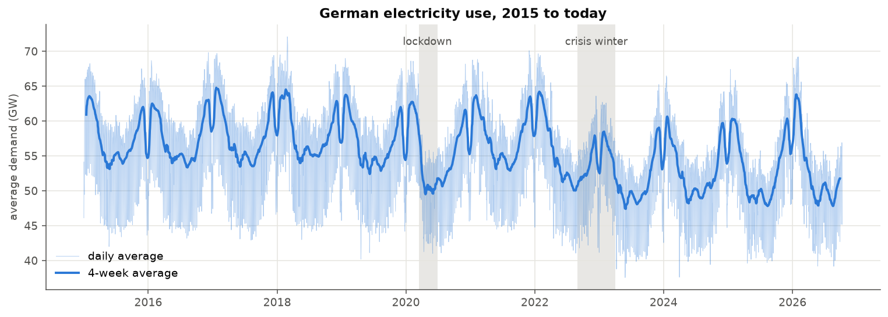

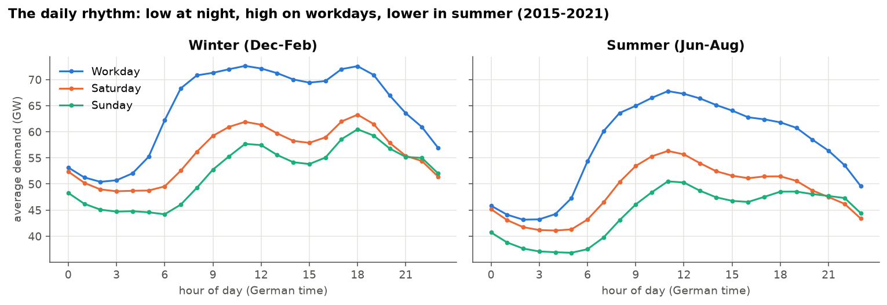

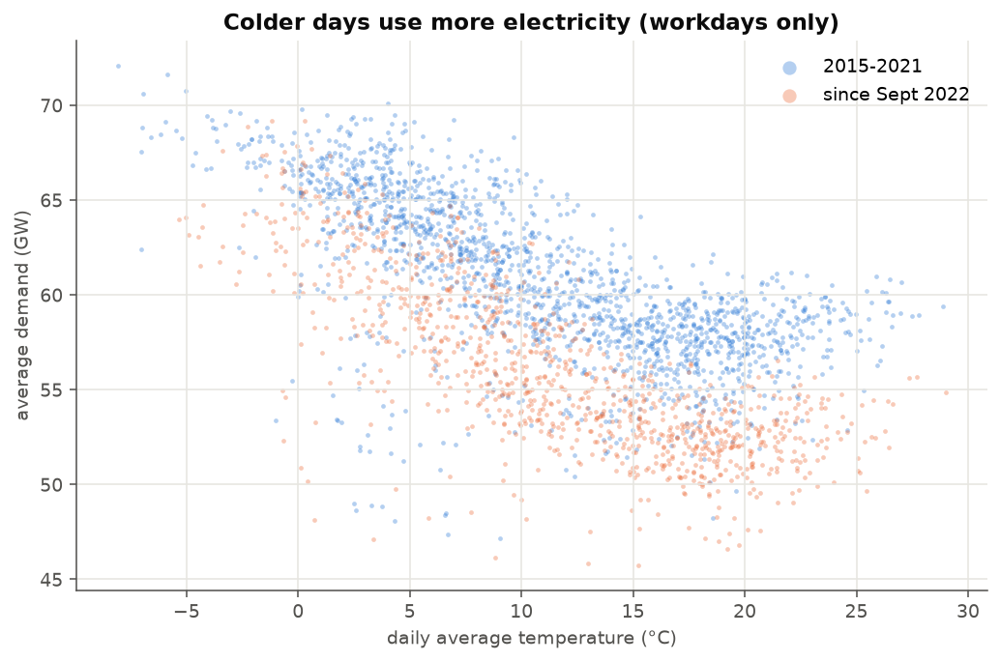

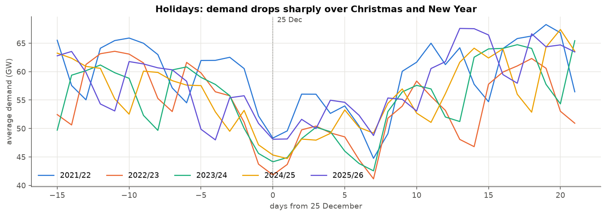

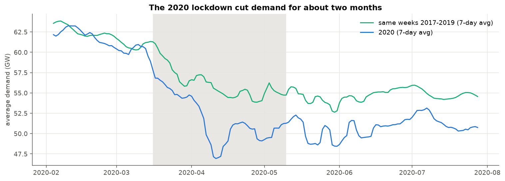

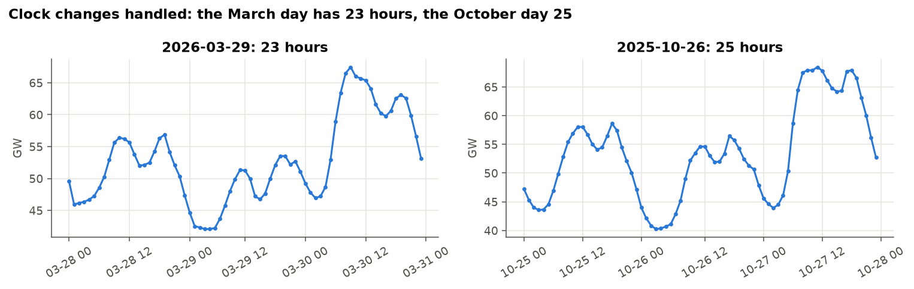

## Sources
- Electricity: Bundesnetzagentur | SMARD.de (CC BY 4.0)
- Weather: Deutscher Wetterdienst (DWD), opendata.dwd.de
- Cross-check: Open Power System Data, time series package 2020-10-06
- Industry: Eurostat, sts_inpr_m
- Holidays: python-holidays
